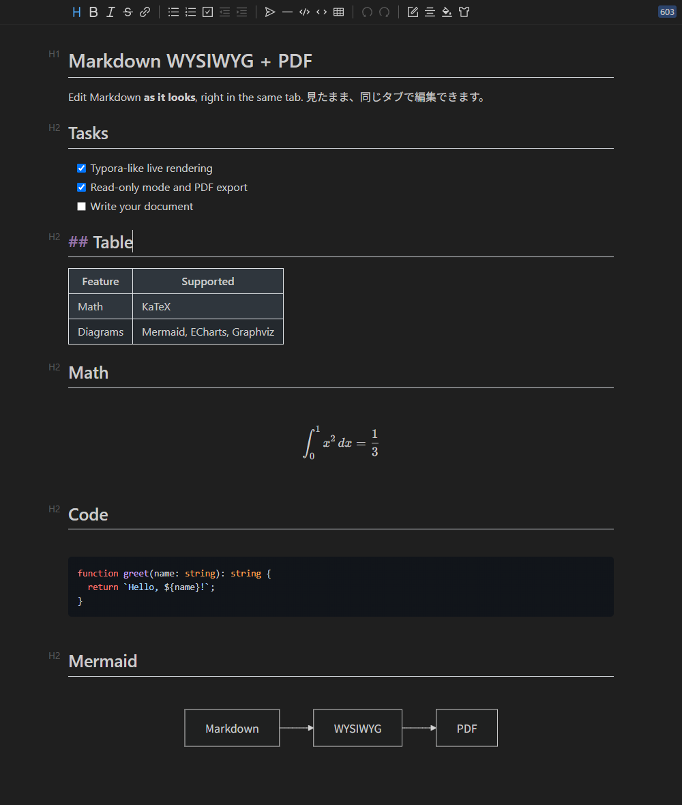
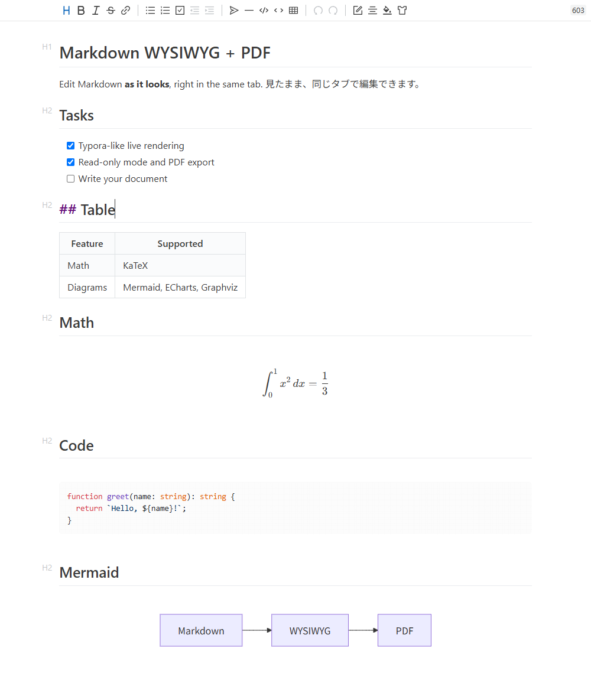

# Markdown WYSIWYG + PDF

[日本語](#日本語)

Edit Markdown files **as they look, in the same tab** — no side-by-side preview needed.
Powered by [Vditor](https://github.com/Vanessa219/vditor) in Typora-like instant rendering mode: Markdown markers appear only where the cursor is.

## Features

- **Opens `.md` files in the WYSIWYG editor by default** (can be turned off)
- **Keeps your writing style** — lines you did not edit are saved exactly as they were (see below)
- **Read-only mode** — 🔒 button in the title bar or `Ctrl+Alt+R`
- **PDF export** — PDF button in the title bar or the Explorer context menu (uses the Edge / Chrome installed on your PC)
- Math (KaTeX), diagrams (Mermaid, ECharts, Graphviz, and more), syntax highlighting, tables, task lists
- Works with VS Code's own save, undo, dirty indicator, Git diff, and side-by-side editing with the text editor
- Follows VS Code's light / dark theme
- Links: `Ctrl+Click` in edit mode, click in read-only mode (relative `.md` links open in VS Code)
- Works offline — all editor assets are bundled

## Usage

- Open a `.md` file. It opens in **"Markdown を見たまま編集"** (the WYSIWYG editor).
- To switch to the text editor, use the icon in the title bar. To switch back, use the icon again or right-click the file in the Explorer.
- To open `.md` files in the text editor by default, turn off `mdWysiwyg.openByDefault`.

The UI is in Japanese.

## Keeps your writing style

Vditor rewrites the whole document every time you edit, which would change lines you never touched
(`[x]` → `[X]`, table column alignment, `***` → `---`, `<https://…>` → `[https://…](https://…)`, trailing double-space line breaks, and so on).

This extension compares the editor output with what it produced right after loading, and **restores the original text for every line you did not edit**.
Lines you edit or add use Vditor's style. A table is treated as one block: editing a cell reformats that table only.
Opening a file never marks it as modified. Set `mdWysiwyg.preserveFormatting` to `false` to save Vditor's output as is.

## Settings

| Setting | Default | Description |
| --- | --- | --- |
| `mdWysiwyg.openByDefault` | `true` | Open `.md` / `.markdown` files in the WYSIWYG editor (off: VS Code's text editor) |
| `mdWysiwyg.readOnlyByDefault` | `false` | Open files in read-only mode |
| `mdWysiwyg.vditor.mode` | `ir` | Editing mode: `ir` (instant rendering), `wysiwyg`, `sv` (split view) |
| `mdWysiwyg.preserveFormatting` | `true` | Keep the original text of lines you did not edit |
| `mdWysiwyg.pdf.browserPath` | auto | Chrome / Edge used for PDF export |
| `mdWysiwyg.pdf.format` | `A4` | Paper size |
| `mdWysiwyg.pdf.margin` | `20mm` | Margin |
| `mdWysiwyg.pdf.pageNumbers` | `true` | Page numbers in the footer |
| `mdWysiwyg.pdf.openAfterExport` | `true` | Open the PDF after exporting |

## Known limitations

- The editor becomes slow on very large files (several thousand lines or more).
- Undo inside the editor uses Vditor's own history, separate from VS Code's undo history.
- When the same file is open in the text editor and changed there, the cursor in the WYSIWYG editor is reset.
- PDF export requires Microsoft Edge or Google Chrome (Edge is preinstalled on Windows).

---

## 日本語

`.md` ファイルを **タブを分割せずに、見たまま** 編集できる VS Code 拡張機能です。
エディタには [Vditor](https://github.com/Vanessa219/vditor) を使っています。Typora のように、カーソルのある部分だけ Markdown の記号が見えます。

### 機能

- **`.md` を最初から見たまま編集で開く**（設定でオフにできます）
- **元の書き方を残す** — 編集していない行は、元のファイルの書き方のまま保存します
- **閲覧モード** — タイトルバーの 🔒 ボタン / `Ctrl+Alt+R`
- **PDF 出力** — タイトルバーの PDF ボタン / エクスプローラーの右クリック（PC の Edge / Chrome を使います）
- 数式（KaTeX）、図（Mermaid・ECharts・Graphviz など）、コードのハイライト、表、タスクリスト
- 保存・元に戻す・未保存マーク・Git の差分・テキストエディタとの同時編集は VS Code の機能がそのまま使えます
- VS Code のライト / ダークテーマに合わせて表示します
- リンクは、編集モードでは `Ctrl+クリック`、閲覧モードではクリックで開きます（相対パスの `.md` は VS Code で開きます）
- オフラインで動作します（エディタの部品をすべて同梱しています）

### 使い方

- `.md` ファイルを開くと「Markdown を見たまま編集」で表示されます。
- テキストエディタへの切り替えはタイトルバーのアイコンから。戻すときも同じアイコンか、エクスプローラーの右クリックから。
- `.md` を最初からテキストエディタで開きたい場合は、設定 `mdWysiwyg.openByDefault` をオフにします
  （コマンドパレットの「Markdown WYSIWYG: \*.md を開く既定のエディタを設定」でも切り替えられます）。

### 元の書き方を残す仕組み

Vditor は編集のたびに文書全体を書き出し直すため、そのままでは触っていない行の書き方まで変わります
（`[x]` → `[X]`、表の列幅揃え、`***` → `---`、`<https://…>` → `[https://…](https://…)`、行末の空白 2 つによる改行が消える、など）。

そこで、読み込んだ直後の Vditor の出力と現在の出力を行単位で比べ、**編集していない行は元のファイルの行に戻してから保存**します。
編集・追加した行は Vditor の書き方になります（`[X]  ` は `[x] ` に直します）。表は 1 つのまとまりとして扱い、表の中を編集するとその表全体が整形されます。
開いただけでは変更扱いになりません。`mdWysiwyg.preserveFormatting` を `false` にすると、Vditor の出力をそのまま保存します。

### 設定

| 設定 | 既定値 | 内容 |
| --- | --- | --- |
| `mdWysiwyg.openByDefault` | `true` | `.md` / `.markdown` を最初から見たまま編集で開く（オフで VS Code 標準のテキストエディタ） |
| `mdWysiwyg.readOnlyByDefault` | `false` | 開いた時点で閲覧モードにする |
| `mdWysiwyg.vditor.mode` | `ir` | 編集モード（`ir` 即時レンダリング / `wysiwyg` / `sv` 分割） |
| `mdWysiwyg.preserveFormatting` | `true` | 編集していない部分を元の書き方のまま保存する |
| `mdWysiwyg.pdf.browserPath` | 自動検出 | PDF 出力に使う Chrome / Edge |
| `mdWysiwyg.pdf.format` | `A4` | 用紙サイズ |
| `mdWysiwyg.pdf.margin` | `20mm` | 余白 |
| `mdWysiwyg.pdf.pageNumbers` | `true` | フッターにページ番号 |
| `mdWysiwyg.pdf.openAfterExport` | `true` | 出力後に PDF を開く |

### 既知の制約

- 数千行を超える大きなファイルでは動作が重くなります。
- エディタ内の「元に戻す」は Vditor 自身の履歴です（VS Code の履歴とは別）。
- 同じファイルをテキストエディタで変更すると、見たまま編集側のカーソル位置がリセットされます。
- PDF 出力には Microsoft Edge か Google Chrome が必要です（Windows には Edge が標準で入っています）。

---

## License

[MIT](LICENSE)

This extension bundles third-party software such as Vditor, Lute, KaTeX, Mermaid, and puppeteer-core.
See [THIRD_PARTY_NOTICES.md](THIRD_PARTY_NOTICES.md) for their licenses.

For development, see [CONTRIBUTING.md](CONTRIBUTING.md). / 開発方法は [CONTRIBUTING.md](CONTRIBUTING.md) を参照してください。
