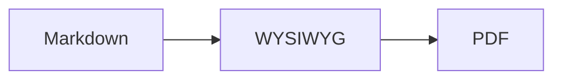

# Markdown WYSIWYG サンプル

このファイルは **Milkdown** と **Vditor** の比較用です。*斜体*、~~取り消し線~~、`インラインコード`、[外部リンク](https://code.visualstudio.com/) と [相対リンク](./other.md)。

## リスト

- 箇条書き 1
- 箇条書き 2
  - ネスト
1. 番号付き
2. 番号付き

- [x] 完了したタスク
- [ ] 未完了のタスク

> 引用ブロックです。

## 表

| 項目 | Milkdown | Vditor |
| --- | --- | --- |
| 編集スタイル | Notion 風 | Typora 風 |
| 数式 | ○ | ○ |

## コード

```ts
function greet(name: string): string {
  return `Hello, ${name}!`;
}
```

## 数式

インライン数式 $E = mc^2$ とブロック数式:

$$
\int_0^1 x^2\,dx = \frac{1}{3}
$$

## 画像


## Mermaid


